# 1. 這是什麼？

**Pixel Studio** 是一個在瀏覽器裡執行的像素繪圖與動畫工具，操作方式參考 Aseprite，特別為 **iPad + Apple Pencil** 與手指觸控設計，也能在 iPhone、Windows、macOS 的瀏覽器使用。

它有三種用法，可以依需求選擇：

| 用法 | 需要什麼 | 適合 |
|---|---|---|
| **A. 只用瀏覽器（單機）** | 任何能開網頁的地方（靜態網站） | 自己畫圖、做動畫；作品存在這台裝置的瀏覽器裡 |
| **B. 電腦開本機伺服器** | 一台電腦安裝 Node.js | 同一個 Wi‑Fi 下讓 iPad／iPhone 一起用、作品存在電腦上、多裝置同步 |
| **C. 再加上 AI 共同創作** | 用法 B + 一把 API 金鑰 | 讓 Claude 等 AI 透過 REST API 或 MCP 直接在你的畫布上作畫，你即時看到、隨時復原 |

> 不開伺服器時，**除了「雲端同步」與「AI API」以外的所有功能都能用**。


# 2. 安裝與啟動

## 2.1 準備：安裝 Node.js（只有用法 B、C 需要）

1. 到 <https://nodejs.org> 下載 **LTS 版（20 以上）** 並安裝。
2. 安裝完成後，打開「終端機」（macOS）或「PowerShell」（Windows），輸入 `node -v`，看到 `v20` 以上的版本號就成功了。

## 2.2 在電腦上啟動

把 `pixel-studio` 資料夾（或解壓縮後的 `pixel-studio.zip`）放到任意位置，在終端機切換到該資料夾，依序輸入：

```bash
npm install        # 第一次才需要，下載必要套件
npm run build      # 產生 dist/ 網站檔案
npm start          # 啟動伺服器
```

建議自己設定一組「擁有者密碼」（登入伺服器、建立 AI 金鑰時要用）：

```bash
# macOS / Linux
OWNER_PASSWORD=你的密碼 npm start

# Windows PowerShell
$env:OWNER_PASSWORD="你的密碼"; npm start

# Windows 命令提示字元 (cmd)
set OWNER_PASSWORD=你的密碼 && npm start
```

啟動後終端機會顯示：

```
🎨 Pixel Studio 伺服器已啟動
   本機:   http://localhost:8787
   區網:   http://192.168.1.20:8787   ← iPad / iPhone 連同一個 Wi-Fi 開這個
   API 文件: http://localhost:8787/docs   MCP: http://localhost:8787/mcp
```

在電腦的瀏覽器（Chrome、Edge、Safari、Firefox）打開 `http://localhost:8787` 即可開始畫圖。若沒有設定 `OWNER_PASSWORD`，系統會自動產生一組密碼，顯示在終端機上，並存在 `data/owner-password.txt`。

要關閉伺服器，在終端機按 `Ctrl + C`。你的作品存在 `data/` 資料夾中，下次啟動仍在。

## 2.3 只用瀏覽器（不開伺服器）

`npm run build` 產生的 `dist/` 資料夾就是一個完整的網站，可以放到任何靜態網站空間，或在電腦上用 `npx serve dist` 開啟。此時右上角圓點為**灰色**，代表「單機模式」，作品自動存在瀏覽器裡。

## 2.4 在 iPad／iPhone 上使用（同一個 Wi‑Fi）

1. 電腦執行 `npm start`，記下終端機顯示的 **「區網」網址**（例如 `http://192.168.1.20:8787`）。
2. iPad／iPhone 連到**和電腦相同的 Wi‑Fi**。
3. 打開 **Safari**，在網址列輸入上面的區網網址。
4. 第一次連不上時：
   - **Windows**：第一次執行 Node 時會跳出防火牆詢問，請勾選「私人網路」並允許；或到「Windows Defender 防火牆 → 允許應用程式通過防火牆」勾選 Node.js。
   - **macOS**：「系統設定 → 網路 → 防火牆 → 選項」，允許 node 接受連入連線。
   - 有些公共／訪客 Wi‑Fi 會阻擋裝置互連，請改用家裡或自己的熱點。

## 2.5 加入主畫面（像 App 一樣全螢幕使用）

在 iPad／iPhone 的 Safari：點**分享按鈕** → **「加入主畫面」** → 「新增」。之後從主畫面圖示開啟，就會以全螢幕 App 的方式執行，沒有網址列，畫布空間更大。

在 Windows／macOS 的 Chrome 或 Edge：網址列右側會出現「安裝」圖示，點下即可。

## 2.6 關於 HTTPS（選用）

瀏覽器規定，**「離線快取」（Service Worker）只能在 `https://` 或 `localhost` 上啟用**。

- 在電腦上用 `http://localhost:8787` 開啟：**可以離線使用**。
- 在 iPad 用 `http://192.168.x.x:8787` 開啟：App 完全可以正常使用、作品一樣自動儲存，**只是不能在斷網時開啟**。

如果你希望 iPad 也能離線開啟，可以用 [mkcert](https://github.com/FiloSottile/mkcert) 產生本機憑證：

```bash
mkcert -install
mkcert 192.168.1.20 localhost
TLS_CERT=./192.168.1.20+1.pem TLS_KEY=./192.168.1.20+1-key.pem OWNER_PASSWORD=你的密碼 npm start
```

再把 mkcert 的根憑證（`mkcert -CAROOT` 資料夾裡的 `rootCA.pem`）用 AirDrop 傳到 iPad 安裝，並到「設定 → 一般 → 關於本機 → 憑證信任設定」開啟完全信任，之後改用 `https://192.168.1.20:8787` 開啟。這一步不做也沒關係。

# 3. 介面導覽

## 3.1 iPad（橫向）

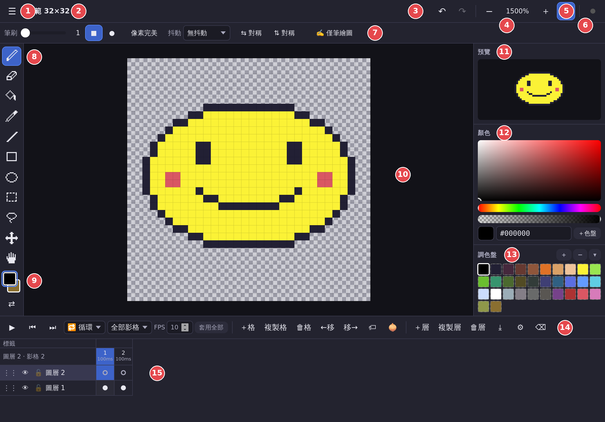

| 編號 | 區域 | 說明 |
|---|---|---|
| 1 | 選單 ☰ | 新增／開啟／儲存／匯出、畫布大小、選取、檢視、伺服器設定、快捷鍵說明 |
| 2 | 專案名稱 | 顯示名稱與尺寸，點一下可重新命名 |
| 3 | 復原 ↶／重做 ↷ | 也可用雙指點按（復原）、三指點按（重做） |
| 4 | 縮放 − 100% ＋ | 點中間的百分比 = 符合視窗 |
| 5 | 像素格線 # | 開關像素格線（放大到 6 倍以上才會顯示） |
| 6 | 伺服器圓點 | 灰 = 單機；黃 = 已偵測到伺服器／連線中；綠 = 即時同步中。點它開啟「伺服器 · 雲端 · AI」設定 |
| 7 | 工具選項列 | 依目前工具顯示：筆刷大小、形狀、像素完美、抖動、對稱、填滿…；最右邊是「✍️ 僅筆繪圖」 |
| 8 | 工具列 | 鉛筆、橡皮擦、油漆桶、滴管、直線、矩形、橢圓、矩形選取、套索、移動、平移 |
| 9 | 主要／次要顏色 | 前方方塊 = 主要色、後方 = 次要色；點選後可在顏色面板編輯；⇄ 交換 |
| 10 | 畫布 | 繪圖區；灰白棋盤格代表透明 |
| 11 | 預覽 | 縮小顯示整張圖；播放動畫時同步播放 |
| 12 | 顏色編輯器 | 飽和度／亮度方塊、色相條、透明度條、十六進位色碼、＋色盤 |
| 13 | 調色盤 | 點色塊選色；＋ 加入目前顏色、− 移除、▾ 調色盤選單（預設色盤、匯入匯出） |
| 14 | 時間軸控制 | 播放、上一格／下一格、播放模式、播放範圍、FPS、影格與圖層的按鈕 |
| 15 | 時間軸格子 | 上方是影格編號與時長，左側是圖層，每一格（cel）實心圓點 = 有內容 |

側邊欄往下捲還有「洋蔥皮」、「參考圖」、「歷史紀錄」三個面板。

## 3.2 iPad（直向）

直向時版面相同，畫布變高、時間軸在下方。

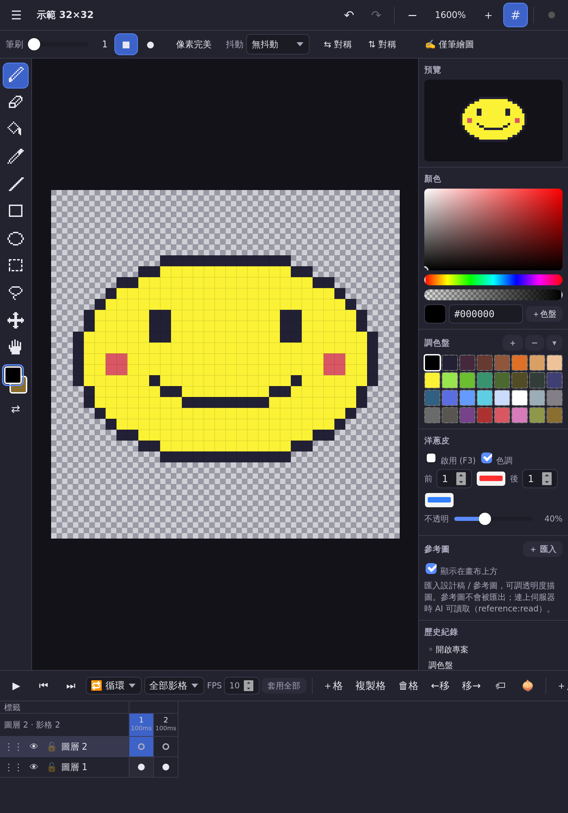{ width=42% }

## 3.3 iPhone

手機螢幕較小，側邊欄與時間軸改成**從下方拉出的面板**；工具列移到畫面底部，可左右滑動看到全部工具。窄螢幕的頂端列放不下格線按鈕時，請用「☰ → 檢視 → 顯示／隱藏像素格線」。

> **觸控裝置的按鈕尺寸（1.1 起）**：在 iPad／iPhone 上，所有按鈕、工具、時間軸格子都至少 44pt（Apple 建議的手指點擊大小），比電腦版大；調色盤色塊為了一次看到更多顏色，維持 30pt。VoiceOver 會念出每個圖示按鈕的名稱。

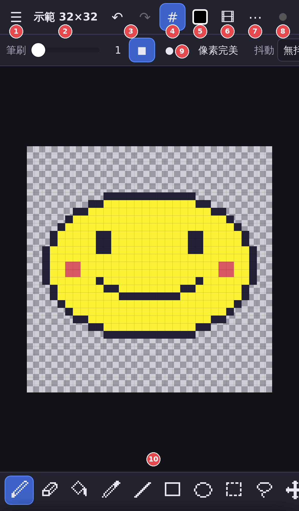{ width=40% }

| 編號 | 按鈕 | 說明 |
|---|---|---|
| 1 | ☰ 選單 | 同 iPad；「檢視 → 符合視窗」在這裡 |
| 2 | 專案名稱 | 點一下重新命名 |
| 3 | ↶ ↷ | 復原／重做 |
| 4 | # | 像素格線 |
| 5 | 顏色方塊 | 打開「顏色／調色盤」面板 |
| 6 | 🎞 | 打開「圖層／時間軸」面板 |
| 7 | ⋯ | 打開其他面板（預覽、洋蔥皮、參考圖、歷史紀錄） |
| 8 | 圓點 | 伺服器／AI 設定 |
| 9 | 工具選項列 | 可左右滑動 |
| 10 | 工具列 | 可左右滑動；最右邊是顏色與交換 |

拉出的面板：**點畫布任何地方、或把面板上方的灰色把手往下滑**就會收起。

<div class="two">

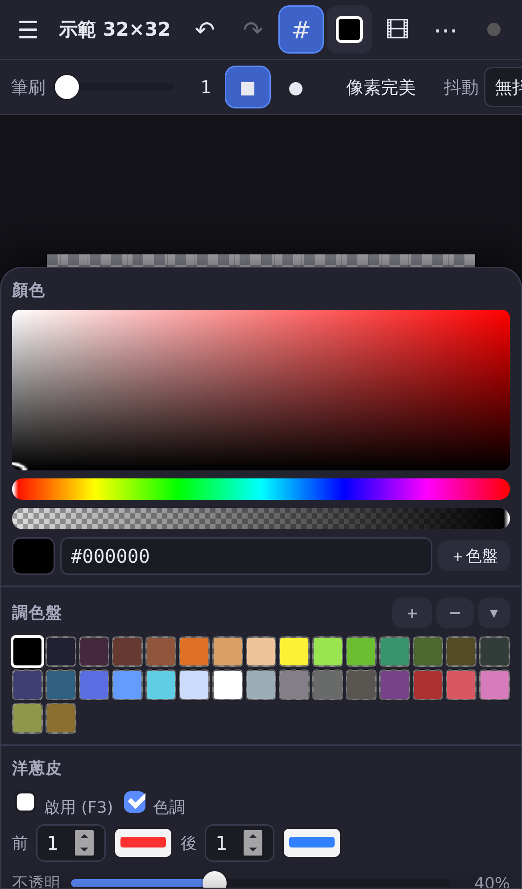

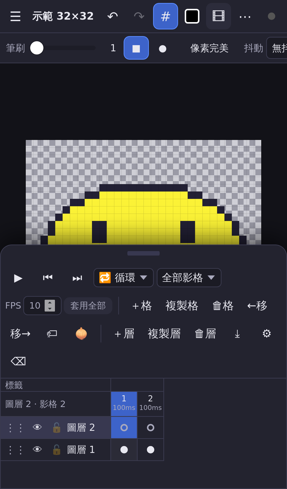

</div>

## 3.4 電腦（Windows／macOS）

版面與 iPad 橫向相同，可以使用滑鼠滾輪縮放、右鍵用次要色畫、完整的鍵盤快捷鍵（見第 15 章）。

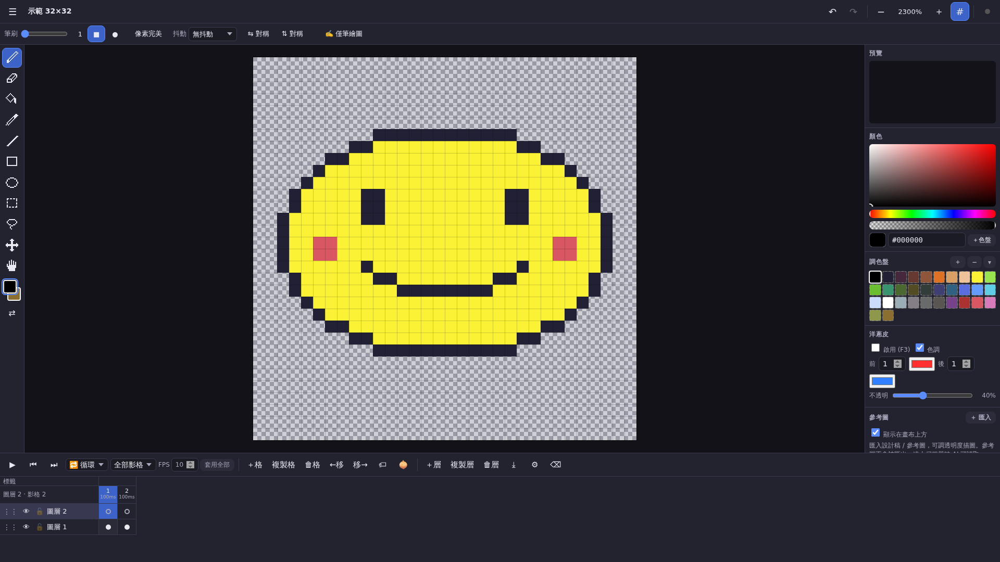

# 4. 繪圖工具

| 工具 | 快捷鍵 | 怎麼用 | 選項（上方工具選項列） |
|---|---|---|---|
| ✏️ 鉛筆 | `B` | 在畫布上拖曳畫線，點一下畫一點 | 筆刷大小 1–32、方形／圓形筆刷、**像素完美**、**抖動**、對稱 |
| 🧽 橡皮擦 | `E` | 擦成透明 | 同鉛筆 |
| 🪣 油漆桶 | `G` | 點一下填滿 | **相連區域**（只填相連的同色區）或 **全部同色**（整張圖同一個顏色都換掉）；有選取範圍時只填選取範圍內 |
| 💧 滴管 | `I` | 點畫面取色 | 取樣「合成畫面」（看到的顏色）或「目前圖層」 |
| ／ 直線 | `L` | 從起點拖到終點 | 筆刷大小、抖動、對稱；按住 `Shift` 鎖定 45° |
| ▭ 矩形 | `U` | 拖曳出矩形 | **填滿**；按住 `Shift` 畫正方形 |
| ◯ 橢圓 | `Shift+U` | 拖曳出橢圓 | **填滿**；按住 `Shift` 畫正圓 |
| ⬚ 矩形選取 | `M` | 拖曳出選取範圍 | 全選、取消、反選、複製、剪下、貼上、刪除、翻轉、旋轉、裁切畫布 |
| ➰ 套索 | `Q` | 手繪任意形狀的選取範圍 | 同矩形選取；`Shift` 加選、`Alt` 減選 |
| ✥ 移動 | `V` | 拖曳移動整個圖層內容；有選取時只移動選取內容 | 方向鍵每次移動 1 像素 |
| ✋ 平移 | `H` | 拖曳移動畫面（不會畫到圖） | 「符合視窗」 |

**選項說明**

- **像素完美**：畫 1 像素線條時，自動去掉轉角多出來的「L 形」像素，線條更乾淨（筆刷大小 1 時有效）。
- **抖動**：用圖樣筆刷上色，可選「棋盤 50%、25%、12%、75%、橫線、直線」，做漸層或質感時很好用。
- **對稱**：「⇆ 對稱」左右鏡射、「⇅ 對稱」上下鏡射，可同時開啟（四向對稱）。畫布上會出現粉紅色虛線表示對稱軸。
- **主要／次要色**：手指／筆／滑鼠左鍵用主要色；電腦上**按滑鼠右鍵用次要色**；`X` 交換兩者。顏色可以有透明度。

## 4.1 選取範圍的操作

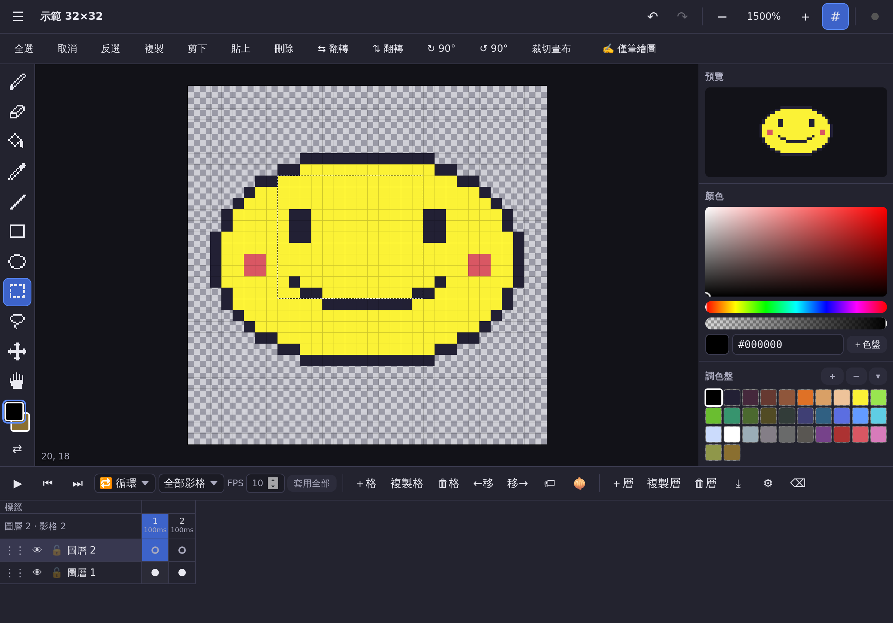{ width=80% }

1. 用矩形選取或套索選出範圍（螞蟻線會閃動）。
2. **直接拖曳選取範圍內部** → 移動那塊像素。
3. **複製 → 貼上**：貼上的內容會浮在畫面上，畫布上方出現「✓ 完成 ✕ 取消 ⇆ ⇅ ↻ ↺ 🗑」浮動列，可拖曳到想要的位置後按 **✓ 完成**（或 `Enter`）。
4. **翻轉／旋轉**：工具選項列的「⇆ 翻轉、⇅ 翻轉、↻ 90°、↺ 90°」。沒有選取範圍時會作用在整個圖層。
5. **裁切畫布**：把整張畫布裁成選取範圍的大小。
6. 在選取範圍外點一下 = 取消選取。

# 5. 顏色與調色盤

- **選色**：點調色盤色塊即設定為目前顏色（主要或次要，看工具列哪個方塊有藍框）。
- **編輯顏色**：在顏色編輯器拖曳方塊（飽和度／亮度）、色相條、透明度條，或直接輸入色碼 `#RRGGBB`／`#RRGGBBAA`（最後兩碼是透明度）。
- **加入調色盤**：顏色編輯器的「＋色盤」或調色盤標題的「＋」。
- **移除**：先點色塊，再按「−」。
- **長按色塊**（電腦上按右鍵）：設為主要色／次要色、以目前顏色取代、從調色盤移除。
- **▾ 調色盤選單**：
  - 載入預設色盤：DawnBringer 32（預設）、PICO‑8、Endesga 32、Game Boy
  - **從畫面擷取所有顏色**
  - 匯入 `.hex`／`.gpl`（GIMP／Aseprite 調色盤格式）
  - 匯出 `.hex`／`.gpl`
  - 清空調色盤

# 6. 圖層

圖層列在時間軸左側（最上面的圖層 = 畫面最上層）。每一列有：

| 按鈕 | 功能 |
|---|---|
| ⋮⋮ | **按住拖曳**到其他圖層的位置，調整上下順序 |
| 👁 | 顯示／隱藏（隱藏的圖層不能畫） |
| 🔒／🔓 | 鎖定／解鎖（鎖定的圖層不能畫，**AI 也無法寫入**） |
| 名稱 | 點一下選取此圖層；電腦上雙擊可開啟屬性 |

時間軸控制列的圖層按鈕：

| 按鈕 | 功能 |
|---|---|
| ＋層 | 新增圖層（`Shift+N`） |
| 複製層 | 複製目前圖層（含所有影格內容） |
| 🗑層 | 刪除目前圖層 |
| ⤓ | 向下合併（`Ctrl+E`），會套用不透明度與混合模式 |
| ⚙ | 圖層屬性：**名稱、不透明度、混合模式**（一般、色彩增值、濾色、覆蓋） |
| ⌫ | 清除目前這一格（cel）的內容 |

> iPad／iPhone 上要改圖層名稱，請選取該圖層後按 **⚙**。

# 7. 動畫時間軸

Pixel Studio 採用和 Aseprite 相同的「影格 × 圖層」結構：每個影格的每個圖層是一個 **cel**。時間軸上實心圓點 = 有內容，空心 = 空白。

## 7.1 影格

| 按鈕 | 快捷鍵 | 功能 |
|---|---|---|
| ＋格 | `Alt+N` | 在目前影格後面新增空白影格 |
| 複製格 | `Alt+D` | 複製目前影格（做動畫最常用：複製後再修改） |
| 🗑格 | — | 刪除目前影格 |
| ←移／移→ | — | 把目前影格往前／往後移 |
| ⏮ ⏭ | `,` `.` | 上一格／下一格 |

- **點影格編號**：切換到該影格。點某一格（cel）：同時切換影格與圖層。
- **每格時長**：影格編號下方顯示時長（毫秒）。**長按影格編號**（電腦上雙擊）可修改；範圍 10–65535 ms。
- **一次設定全部**：在 FPS 欄輸入每秒格數（1–60），按「套用全部」。
- **選取多個影格**：先點第一格，再按住 `Shift` 點最後一格；此時修改時長會套用到整段，新增標籤也會預設這段範圍。

## 7.2 播放

- ▶／⏸（或 `Enter`）播放與暫停。
- 播放模式：**🔁 循環**、**↔ 來回**（ping‑pong）、**→ 單次**。
- 播放範圍：「全部影格」或指定某個標籤。

## 7.3 標籤（Tags）

標籤是一段有名字的影格範圍，例如 `idle`（待機）、`walk`（走路）、`attack`（攻擊），方便分段播放與匯出。

1. （選用）先用 `Shift` 選好影格範圍。
2. 按 🏷，輸入名稱、起訖影格、方向（正向／反向／來回）與顏色，按「儲存」。
3. 標籤會顯示在時間軸最上方；點標籤可以編輯、刪除，或「設為播放範圍」。

# 8. 洋蔥皮（Onion Skin）

做動畫時，把前後影格半透明地疊在畫面上，方便對齊動作。

{ width=80% }

- 開關：時間軸的 🧅 按鈕或 `F3`。
- 設定（側邊欄「洋蔥皮」面板）：
  - **前／後**：顯示前面幾格、後面幾格（0–10），越遠越淡。
  - **色調**：開啟時過去影格染成紅色、未來影格染成藍色（顏色可自訂）；關閉則顯示原色。
  - **不透明**：整體透明度。
- 播放時洋蔥皮會自動隱藏；洋蔥皮**不會被匯出**。

# 9. 參考圖（描圖用）

把設計稿、照片或草圖放在畫布上當半透明底圖：

1. 側邊欄「參考圖」面板按「＋ 匯入」（或選單「匯入參考圖…」），選擇圖片。iPad／iPhone 可以直接從「照片」或「檔案」選。
2. 參考圖會自動縮放到畫布大小，預設 50% 透明。
3. 可調整：顯示／隱藏、**透明度**、**X／Y 位置**、**縮放**、「像素化顯示」（不模糊）、「顯示在畫布上方」（取消勾選則在圖下方）。
4. 🗑 刪除參考圖。

> 參考圖**不會被匯出**到 PNG／GIF 等成品中。連上伺服器並授權 `reference:read` 時，AI 可以讀取參考圖，照著設計稿作畫。

# 10. 畫布、縮放與格線

- **縮放**：雙指捏合（觸控）、滑鼠滾輪、觸控板捏合、`+`／`−`、頂端的 −／＋ 按鈕。最小 25%、最大 12800%。
- **符合視窗**：點頂端百分比、`0` 鍵，或選單「檢視 → 符合視窗」。
- **平移**：雙指拖曳、平移工具 ✋、電腦上按住空白鍵拖曳或滑鼠中鍵拖曳。
- **像素格線**：頂端 `#`（`Ctrl+'`）。
- **自訂格線**：選單「檢視 → 自訂格線…」，例如 8×8 或 16×16 的 tile 格線，可選顏色。
- **畫布大小**：選單「編輯 → 畫布大小／縮放…」：
  - 輸入新寬高（1–2048），用 9 宮格選擇內容要對齊的位置（錨點）。
  - **縮放整個精靈**：×0.5、×2、×3、×4（最近鄰演算法，像素不模糊）。
- **裁切到選取範圍**：選單或選取工具的「裁切畫布」。

新增專案（選單「新增專案…」或 `Ctrl+N`）時可選 16、32、64、128、256、320×180 等預設尺寸，或自訂寬高與調色盤：

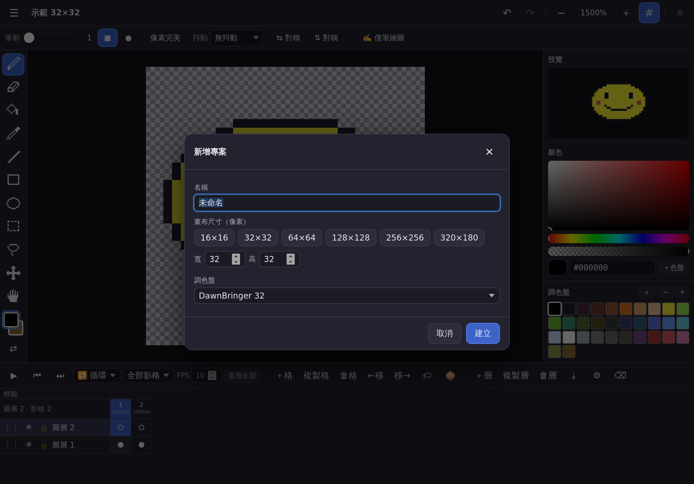{ width=80% }

# 11. 復原、重做與歷史紀錄

- 復原：↶ 按鈕、`Ctrl+Z`（Mac：`⌘Z`）、**雙指點按畫布**。
- 重做：↷ 按鈕、`Ctrl+Y` 或 `Ctrl+Shift+Z`、**三指點按畫布**。
- 最多保留 **200 步**，並受復原記憶體上限保護（見下方說明）。
- 側邊欄「**歷史紀錄**」面板列出每一步；**點任一步就能直接跳回那個狀態**，再點後面（變淡的）步驟可以跳回來。
- AI 透過 API 做的修改也會出現在歷史中，顯示為綠色的「🤖 金鑰名稱：動作」，你可以直接復原。

> **復原記憶體（1.3 起）**：歷史紀錄面板最下方會顯示「N 步 · 復原記憶體 X / Y MB」。為了避免 iPad 的 Safari 因記憶體不足而重新載入頁面（造成作品遺失），超過上限時會自動移除最舊的步驟（至少保留最新 10 步），並提示一次。作品本身不受影響。

# 12. 觸控手勢與 Apple Pencil

| 手勢 | 功能 |
|---|---|
| 單指拖曳 | 用目前工具繪圖（開啟「僅筆繪圖」時改為平移畫面） |
| Apple Pencil | 繪圖 |
| 雙指捏合 | 縮放 |
| 雙指拖曳 | 平移畫面 |
| **雙指點按** | 復原 |
| **三指點按** | 重做 |
| 長按調色盤色塊 | 色塊選單 |
| 長按影格編號 | 修改影格時長 |
| 按住 ⋮⋮ 拖曳 | 調整圖層順序 |
| 面板把手往下滑 | 收起面板（iPhone） |

**防誤觸（✍️ 僅筆繪圖）**：第一次偵測到 Apple Pencil 或觸控筆時，會自動開啟「僅筆繪圖」並顯示提示。開啟後，**只有筆能畫圖，手掌與手指只會平移／縮放**，不會不小心畫到。想用手指畫圖，到工具選項列最右邊按「✍️ 僅筆繪圖」關閉即可。

> 本工具刻意不做 Apple Pencil 壓力感應（像素畫不需要筆壓）。

整個 App 已關閉 Safari 的「雙擊放大」、頁面捏合縮放與畫面回彈，繪圖時畫面不會亂跑。

# 13. 匯出

選單「匯出（PNG／GIF／APNG／精靈圖）…」（`Ctrl+Shift+E`）：

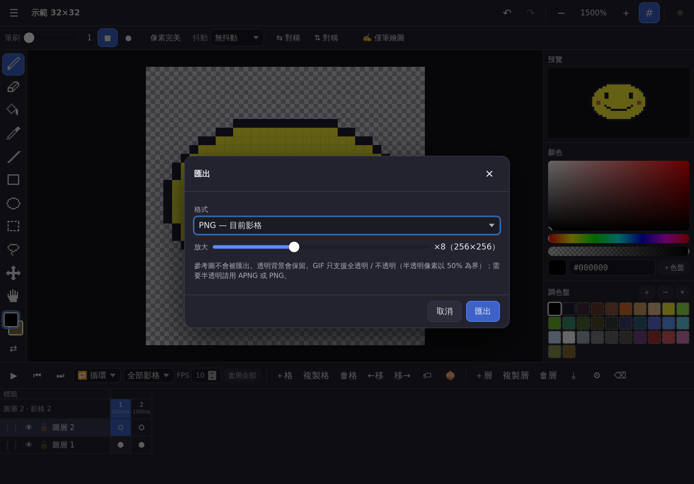{ width=80% }

| 格式 | 內容 | 透明度 | 選項 |
|---|---|---|---|
| **PNG — 目前影格** | 一張 PNG | 完整保留（含半透明） | 放大 ×1–×20 |
| **PNG — 所有影格（ZIP）** | 每格一張 PNG，打包成 ZIP | 完整保留 | 放大、範圍（全部／目前／某標籤） |
| **精靈圖 PNG + JSON** | 所有影格排成一張圖 + Aseprite 相容的 JSON（每格位置、時長、標籤、圖層） | 完整保留 | 橫排／直排／格狀（欄數）、打包 ZIP |
| **GIF 動畫** | 可在任何地方播放的動畫 | 只有全透明／不透明（半透明以 50% 為界） | 放大、範圍、循環／來回／單次 |
| **APNG 動畫** | 高品質 PNG 動畫 | 完整 8‑bit 透明度 | 放大、範圍、循環／來回／單次 |
| **.pxs 專案檔** | Pixel Studio 原始專案（含圖層、影格、標籤、參考圖） | — | — |

- 放大使用**最近鄰演算法**，像素邊緣銳利、不模糊。
- 參考圖與洋蔥皮不會被匯出。
- **在 iPad／iPhone 上**：Safari 會詢問「是否要下載」，下載的檔案在「檔案」App 的「下載項目」資料夾。因為 Safari 一次點擊只允許一個下載，**精靈圖的 PNG 與 JSON 在 iPad／iPhone 上會自動打包成一個 ZIP**（在「檔案」App 點一下即可解壓）。
- 從**主畫面開啟（App 模式）**時，匯出會改用 iOS 的分享面板，可選「儲存到檔案」或「儲存影像」。

# 14. 匯入與開啟

選單「開啟／匯入檔案（.pxs、PNG、GIF）…」，或在電腦上直接把檔案**拖曳到視窗**：

| 檔案 | 結果 |
|---|---|
| `.pxs` | 開啟專案（若和現有專案同 ID，會另存為新專案，不會覆蓋） |
| PNG／JPG／WebP | 詢問要開成 **新專案**、加成 **新圖層**，或當 **參考圖** |
| GIF 動畫 | 同上；動畫的每一格會變成影格（含每格時長） |
| 剪貼簿圖片 | 電腦上 `Ctrl+V` 直接貼上為浮動選取 |

- 新專案／圖片的尺寸上限為 2048×2048。
- 在 iPad／iPhone 上選取 `.pxs` 時，檔案選擇器會顯示所有檔案（iOS 不認得 .pxs 副檔名），選錯檔案時 App 會提示「不是 Pixel Studio 專案檔」。

# 15. 儲存方式

Pixel Studio 有三層保護，平常**不需要手動儲存**：

1. **瀏覽器自動儲存**：每次修改後約 1 秒，自動存到這台裝置的瀏覽器（IndexedDB）。關掉分頁、重新開機後再打開，會回到上次的專案。所有專案在選單「**專案列表…**」（`Ctrl+O`）裡，可開啟或刪除（🗑）。
2. **下載 .pxs 專案檔**：選單「下載專案檔 .pxs」（`Ctrl+Shift+S`），可以備份、傳給別人、在別台裝置開啟。
3. **伺服器（雲端）**：連上本機伺服器並同步後，每次修改都會即時存到電腦的 `data/` 資料夾，多台裝置可以開同一個專案。

> ⚠️ **重要（iPhone／iPad 的 Safari）**：Safari 可能會清除「超過 7 天沒有開啟的網站」的瀏覽器資料。為了避免作品不見，建議：**把 App 加入主畫面**（主畫面 App 不受此限制）、定期**下載 .pxs 備份**，或**使用伺服器同步**。另外，Safari 的「私密瀏覽」模式關閉分頁後資料就會消失。

**怎麼知道已經存好了？（1.2 起）** 專案名稱前有一個小圓點：🟢 綠色＝已存到這台裝置；🟡 黃色＝剛修改、正在儲存；🔴 紅色＝儲存失敗。

儲存失敗時（最常見是 iPad 儲存空間不足），畫面上方會出現紅色提示列：
- **下載 .pxs 備份**：先把目前作品存成檔案（主畫面 App 會開啟分享面板，選「儲存到檔案」）。
- **重試**：清出空間後按一下；系統也會每隔一段時間自動重試。
- **管理專案**：開啟專案列表，刪除不用的專案以釋放空間。

「☰ → 關於」可看到已用／可用的儲存空間與是否已啟用「持久儲存」。

**保護作品的兩個提醒（1.5 起）**
- **加入主畫面**：在 iPad／iPhone 的 Safari 分頁中使用時，上方會出現藍色提示。Safari 若 7 天沒有開啟本 App，可能會清除網站資料（含作品）；加入主畫面後以 App 方式開啟較不會被清除，也能離線使用。按「如何加入」看步驟。**注意：主畫面 App 與 Safari 分頁的資料是分開的**，要搬移作品請先下載 .pxs，再到主畫面 App 匯入。
- **備份提醒**：超過 7 天沒有下載 .pxs 備份時會提醒你，按「下載備份」即可（建議存到「檔案」或雲端硬碟）。
- 兩個提醒都可以按「稍後」，7 天內不再出現。「☰ → 關於」可看到最後備份時間與目前是主畫面 App 還是瀏覽器分頁。

**專注模式（1.6 起）**：按頂端列「⛶」、☰ →「專注模式」或鍵盤 Tab，隱藏頂端列、選項列、側邊面板與時間軸，畫布最大化；左上角浮動小工具可復原、重做或「離開專注」。工具列仍在，可直接換工具。

**臨時吸管／橡皮擦（1.7 起）**：畫布右上角「吸」「擦」按鈕，點一下後下一筆就是滴管或橡皮擦，完成自動回到原工具。

## 15.1 使用伺服器同步（雲端）

1. 點右上角圓點 → 輸入擁有者密碼 → 「登入」。
2. 「同步」分頁 → **「☁️ 上傳並同步目前專案」**。圓點變**綠色**＝即時同步中。
3. 之後在任何裝置（同一個伺服器）登入，從「專案列表 → 伺服器專案」開啟同一個專案。
4. 「停止同步此專案」：之後只存在本機，伺服器上的副本保留。
5. 若你在離線時修改、同時伺服器上也有新變更（例如 AI 畫的），App 會載入伺服器版本，並把你的離線修改**另存為「本機衝突副本」**，不會遺失。

# 16. AI 共同創作

連上本機伺服器後，你可以讓 AI（例如 Claude Desktop、Claude Code、Cursor 等支援 MCP 的工具，或任何能呼叫 HTTP API 的程式）**直接在你的畫布上作畫**。AI 每畫一筆，你的畫面會即時更新，歷史紀錄出現「🤖」項目，隨時可以復原。

## 16.1 建立 API 金鑰

1. 點右上角圓點 → 用擁有者密碼登入。
2. 「同步」分頁：先把要讓 AI 畫的專案**上傳到伺服器**（AI 只能存取伺服器上的專案）。
3. 「**API 金鑰**」分頁：
   - **名稱**：例如「Claude」——之後歷史紀錄與活動紀錄都會顯示這個名稱。
   - **權限範圍**：勾選 AI 可以做的事（見下表）。
   - **可存取的專案**：「全部專案」或「指定專案」（只勾選允許的專案）。
   - **速率限制**：每分鐘最多幾次請求（預設 120）。
4. 按「建立金鑰」。**金鑰只會顯示這一次**，請立即按「複製金鑰」妥善保存。下方會同時顯示可以直接複製使用的 curl 與 MCP 設定範例。
5. 不再使用時，在金鑰列表按「撤銷」，使用該金鑰的 AI 會立刻失去存取權。

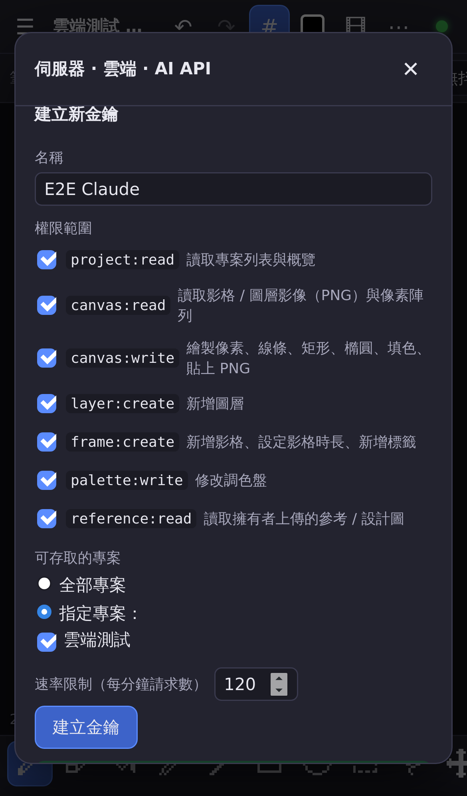{ width=45% }

| 權限範圍 | 允許 AI 做的事 |
|---|---|
| `project:read` | 列出專案、看專案概覽（尺寸、圖層、影格、標籤、調色盤） |
| `canvas:read` | 取得影格／圖層 PNG 圖片、精靈圖、像素陣列（讓 AI「看見」畫面） |
| `canvas:write` | 畫像素、直線、矩形、橢圓、填色、貼上 PNG |
| `layer:create` | 新增圖層 |
| `frame:create` | 新增影格、設定影格時長、新增標籤 |
| `palette:write` | 修改調色盤 |
| `reference:read` | 讀取你上傳的參考圖／設計稿 |

## 16.2 用 REST API 連接（curl 範例）

```bash
KEY=pxs_你的金鑰
BASE=http://localhost:8787
PID=你的專案ID        # 「同步」分頁或 list_projects 可以看到

# 列出專案、看概覽
curl -H "Authorization: Bearer $KEY" $BASE/api/v1/projects
curl -H "Authorization: Bearer $KEY" $BASE/api/v1/projects/$PID

# 下載第 1 格的圖片（放大 8 倍）
curl -H "Authorization: Bearer $KEY" "$BASE/api/v1/projects/$PID/image?frame=0&scale=8" -o frame0.png

# 畫幾個像素
curl -X POST -H "Authorization: Bearer $KEY" -H "Content-Type: application/json" \
  -d '{"layer":0,"frame":0,"pixels":[[1,1,"#ff004d"],[2,1,"#ff004d"]]}' \
  $BASE/api/v1/projects/$PID/draw/pixels

# 畫一個填滿的橢圓
curl -X POST -H "Authorization: Bearer $KEY" -H "Content-Type: application/json" \
  -d '{"shape":"ellipse","x0":4,"y0":4,"x1":20,"y1":16,"color":"#ffec27","filled":true}' \
  $BASE/api/v1/projects/$PID/draw/shape

# 複製第 1 格成新影格（做動畫）
curl -X POST -H "Authorization: Bearer $KEY" -H "Content-Type: application/json" \
  -d '{"copyFrom":0,"duration":120}' $BASE/api/v1/projects/$PID/frames
```

座標原點在左上角 (0,0)；`layer` 可以是索引（0 = 最底層）、圖層 ID 或名稱；`frame` 是影格索引（0 = 第 1 格）。完整 API 文件在 `http://localhost:8787/docs`，OpenAPI 規格在 `/api/openapi.json`。

## 16.3 用 MCP 連接（Claude Desktop／Cursor 等）

MCP 端點：`http://localhost:8787/mcp`，使用同一把金鑰。在 MCP 用戶端的設定檔加入：

```json
{
  "mcpServers": {
    "pixel-studio": {
      "type": "http",
      "url": "http://localhost:8787/mcp",
      "headers": { "Authorization": "Bearer pxs_你的金鑰" }
    }
  }
}
```

Claude Code 可以直接用一行指令加入：

```bash
claude mcp add --transport http pixel-studio http://localhost:8787/mcp --header "Authorization: Bearer pxs_你的金鑰"
```

只支援 stdio 的用戶端，透過 `mcp-remote` 轉接：

```json
{
  "mcpServers": {
    "pixel-studio": {
      "command": "npx",
      "args": ["-y", "mcp-remote", "http://localhost:8787/mcp",
               "--header", "Authorization: Bearer pxs_你的金鑰"]
    }
  }
}
```

連上後，對 AI 說類似「請看 Pixel Studio 裡的參考圖，在第 1 格畫一隻 32×32 的小貓，再做 4 格走路動畫」即可。建議的流程是：`list_projects` → `get_project_overview` → `get_reference_images`（看設計稿）→ `get_frame_image`（看目前畫面）→ `add_frame` + `draw_*` 逐格修改 → `set_frame_duration`／`add_tag`。

> 雲端上的 AI 服務（例如 ChatGPT 網頁版的連接器）**連不到你電腦的 localhost 或區網位址**。若真的需要，必須透過公開的 HTTPS 網址（例如 `cloudflared tunnel --url http://localhost:8787`），並務必使用強密碼、只給必要的權限。

## 16.4 AI 能做與不能做的事

| AI 可以 | AI 不可以（伺服器端強制，不只是文件說明） |
|---|---|
| 看專案資訊、看畫面圖片、看參考圖（需對應權限） | **刪除任何東西**：專案、圖層、影格、cel 都不能刪；所有 `DELETE` 請求一律回 403 |
| 畫像素、線、矩形、橢圓、填色、貼圖 | 把一個有內容的 cel **整個擦成空白**（回 403 `forbidden_clear`） |
| 新增圖層、新增影格、設定時長、新增標籤 | 寫入你**鎖定 🔒 的圖層**（回 423） |
| 修改調色盤（需 `palette:write`） | 存取**未授權的專案**（回 403）或超過速率限制（回 429） |
| | 呼叫名稱含 delete／remove／clear 的 MCP 工具（一律拒絕） |

> 想保護某個圖層（例如你畫好的線稿）不被 AI 改動，只要把它**鎖定**。

## 16.5 即時同步、活動紀錄與還原

- 你在 App 中開著已同步的專案時，AI 的每一筆修改都會**即時出現在畫布上**，並跳出綠色提示、在歷史紀錄出現「🤖 Claude：…」。
- 按**復原**（↶、`Ctrl+Z` 或雙指點按）就能撤銷 AI 的修改，結果會同步回伺服器。
- 「**活動紀錄**」分頁列出每把金鑰做過的每個動作（時間、金鑰名稱、動作、內容、經由 REST 或 MCP）。寫入類的動作可以按「**還原**」單獨撤銷。

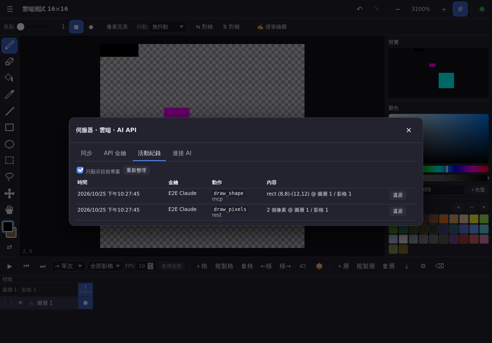{ width=85% }

> 注意：「還原」會把那一格（cel）恢復成該動作之前的樣子，**之後對同一格的修改（包括 AI 後續的動作）也會一併被還原**。只想撤銷最近幾步時，用一般的「復原」最直覺。
>
> App 關閉期間 AI 做的修改，下次開啟專案時會自動載入。

# 17. 快捷鍵總表

| 快捷鍵 | 功能 | 快捷鍵 | 功能 |
|---|---|---|---|
| `B` | 鉛筆 | `Ctrl+Z` | 復原 |
| `E` | 橡皮擦 | `Ctrl+Y`／`Ctrl+Shift+Z` | 重做 |
| `G` | 油漆桶 | `Ctrl+C`／`X`／`V` | 複製／剪下／貼上 |
| `I` | 滴管（繪圖時按住 `Alt` 暫時切換） | `Delete` | 刪除選取內容（無選取時清除 cel） |
| `L` | 直線 | `Ctrl+A`／`Ctrl+D` | 全選／取消選取 |
| `U`／`Shift+U` | 矩形／橢圓 | `Ctrl+Shift+I` | 反轉選取 |
| `M` | 矩形選取 | `Enter`／`Esc` | 確定／取消浮動選取 |
| `Q` | 套索 | 方向鍵 | 選取內容移動 1px（無選取時 ←→ 換影格） |
| `V` | 移動（繪圖時按住 `Ctrl` 暫時切換） | `Shift+H`／`Shift+V` | 水平／垂直翻轉 |
| `H`／空白鍵拖曳／中鍵 | 平移畫面 | `,`／`.` | 上一格／下一格 |
| `X` | 交換主要／次要色 | `Enter`（無選取） | 播放／暫停 |
| `[`／`]` | 筆刷變小／變大 | `Alt+N`／`Alt+D` | 新增影格／複製影格 |
| `+`／`-`／`0` | 放大／縮小／符合視窗 | `Shift+N` | 新增圖層 |
| `Ctrl+'` | 像素格線 | `Ctrl+E` | 向下合併 |
| `Ctrl+S` | 立即儲存 | `F3` | 洋蔥皮 |
| `Ctrl+Shift+S` | 下載 .pxs | `Ctrl+N`／`Ctrl+O` | 新增專案／專案列表 |
| `Ctrl+Shift+E` | 匯出 | 滾輪／觸控板捏合 | 縮放 |

macOS 上 `Ctrl` 也可以用 `⌘`。iPad 接上巧控鍵盤時同樣可以使用這些快捷鍵。選單「快捷鍵說明」可隨時查看。

# 18. 常見問題與疑難排解

**Q：iPad 開不了區網網址？**
確認 iPad 與電腦在同一個 Wi‑Fi、電腦的伺服器還在執行（終端機沒有關）、防火牆已允許 Node.js（見 2.4）。也可以先在電腦瀏覽器開區網網址測試。

**Q：右上角圓點一直是灰色？**
灰色＝單機模式（沒有偵測到伺服器）。若你是用 `npm start` 啟動的網址開啟，請重新整理；若用的是 `dist/` 靜態網站，那本來就沒有伺服器功能。

**Q：圓點是黃色？**
已偵測到伺服器但尚未登入，或目前專案尚未上傳同步。點圓點登入並在「同步」分頁上傳。

**Q：手指畫不出東西？**
可能開啟了「✍️ 僅筆繪圖」（使用過 Apple Pencil 後會自動開啟），到工具選項列最右邊關閉。也請確認目前圖層沒有被隱藏 👁 或鎖定 🔒（App 會跳出提示）。

**Q：畫錯了怎麼辦？**
雙指點按畫布＝復原，三指點按＝重做；或在「歷史紀錄」面板直接點回之前的步驟。

**Q：作品不見了？**
先打開「專案列表」看看是否在其他專案裡。若 Safari 清除了網站資料，只能從 .pxs 備份或伺服器還原——這就是為什麼建議加入主畫面、定期下載 .pxs，或使用伺服器同步（見第 15 章）。

**Q：GIF 的半透明顏色不見了？**
GIF 格式只支援全透明或不透明。需要半透明請匯出 APNG 或 PNG。

**Q：iPhone 匯出的檔案在哪裡？**
「檔案」App →「下載項目」。從主畫面 App 匯出時，會出現分享面板，選「儲存到檔案」。

**Q：不能刪除 AI 畫的東西嗎？**
可以。AI **不能**刪除，但**你**可以：復原、在活動紀錄按「還原」、用橡皮擦、清除 cel、刪除圖層或影格都可以。

**Q：AI 說「423」或「無法寫入」？**
那個圖層被鎖定了 🔒，解鎖即可（或請 AI 改畫在其他圖層）。

**Q：伺服器忘記密碼？**
用 `OWNER_PASSWORD=新密碼 npm start` 重新啟動即可；若沒設定環境變數，自動產生的密碼在 `data/owner-password.txt`。

**Q：畫面卡卡的？**
非常大的畫布（例如 1024×1024 以上、很多圖層與影格）會比較耗效能，建議像素畫維持在 256×256 以內。

## 18.x 回報問題：診斷資訊（1.4 起）

遇到問題時，請開啟「☰ → 診斷資訊（回報問題用）」，按「複製」或「下載診斷檔」，連同 iPad 型號與 iPadOS 版本一起回報。內容包含版本、裝置與視窗大小、離線快取、儲存空間、專案大小與最近的錯誤紀錄，**不包含你的作品內容**，也不會自動傳送到任何地方。

**Apple Pencil 快速短筆畫漏畫？** 1.4 已針對 iPadOS「隨手寫（Scribble）」攔截筆畫的問題修正。若仍發生，請到「設定 → Apple Pencil」暫時關閉「隨手寫」比較，並回報診斷資訊。

# 19. 已知限制

- 動畫 WebP 匯出尚未實作（請用 APNG 或 GIF）。
- GIF 只有 1‑bit 透明（alpha < 50% 視為透明）。
- 同時在多個裝置編輯**同一格（cel）**時，以最後寫入者為準；不同 cel 不會互相覆蓋。
- 沒有 Apple Pencil 壓力感應（刻意不做）；沒有連結 cel（linked cels）、切片（slices）、tilemap。
- 單一擁有者帳號，沒有多使用者權限。
- 活動紀錄的「還原」以 cel 為單位，會一併還原之後對同一格的修改。
- 用 `http://` 區網網址開啟時無法離線開啟（見 2.6）。
- 歷史紀錄最多 200 步，並受記憶體上限保護（iPad 96 MB）；超過時會自動移除最舊的步驟。重新開啟專案後歷史會清空（作品本身會保留）。
- 觸控裝置上無法用雙擊重新命名圖層，請用 ⚙ 圖層屬性。

# 20. 附錄：測試環境

本版本以自動化瀏覽器測試（`npm run e2e`）在以下環境逐項驗證，所有工具、圖層、時間軸、匯出入、自動儲存、離線快取、伺服器同步、API 金鑰與 AI 繪圖即時同步都通過：

| 裝置設定 | 瀏覽器引擎 | 方向 |
|---|---|---|
| iPad Pro 11 吋 | WebKit（Safari 核心） | 橫向、直向 |
| iPad（第 7 代） | WebKit | 橫向、直向 |
| iPad mini | WebKit | 橫向、直向 |
| iPhone 14 | WebKit | 直向、橫向 |
| Windows／桌面 1920×1080 | Chromium（Chrome／Edge 核心） | — |

> 這些測試是在 Linux 上以 Safari 的 WebKit 引擎模擬 iPad／iPhone 的螢幕尺寸與觸控，並非實機。真正的 Apple Pencil 手感與 iPadOS Safari 的細節，仍以你的實機體驗為準；若發現問題，請記下裝置型號與 iPadOS 版本回報。

# 21. 版本與更新紀錄

目前版本可在「☰ 選單 → 關於 Pixel Studio」查看。完整變更見專案的 CHANGELOG.md。
- **1.0.1**（2026-10-26）：修正寫死的版本號（關於、/api/health、MCP、OpenAPI、精靈圖 JSON）；版本單一來源；平行 e2e
- **1.1.0**（2026-10-27）：iPad 觸控目標 ≥ 44pt、VoiceOver 無障礙名稱（ADR-002）
- **1.2.0**（2026-10-27）：儲存狀態指示、自動儲存失敗（空間不足）橫幅＋備份＋自動重試
- **1.3.0**（2026-10-27）：復原歷史記憶體預算（ADR-003）＋單元測試層 npm test
- **1.4.0**（2026-10-27）：診斷資訊與錯誤擷取；修正 iPadOS Scribble 吃掉快速 Apple Pencil 筆畫
- **1.5.0**（2026-10-27）：資料安全：加入主畫面引導、7 天備份提醒、IndexedDB 連線自動重連（ADR-006）
- **1.6.0**（2026-10-27）：專注模式：一鍵隱藏面板、畫布最大化（ADR-007）
- **1.7.0**（2026-10-27）：臨時橡皮擦／吸管一次性按鈕（B12）
- **1.7.1**（2026-10-27）：同點快速重複點畫守門測試（B13）
- **1.7.2**（2026-10-27）：效能基準與座標換算單元測試（B15）
- **1.7.3**（2026-10-27）：R2 橫向評比（review-02，僅文件）
- **1.7.4**（2026-10-27）：pointercancel 守門測試（B19）
- **1.8.0**（2026-10-27）：Shift 直線等角 2:1 鎖角（B16）
- **1.8.1**（2026-10-27）：對稱與抖動設定重開後保留
- **1.9.0**（2026-10-27）：長按吸色：手指／Apple Pencil 在畫布按住不動 0.6 秒即吸取顏色
- **1.10.0**（2026-10-27）：長按吸色可調：0.4／0.6／0.9 秒或關閉，設定會記住
